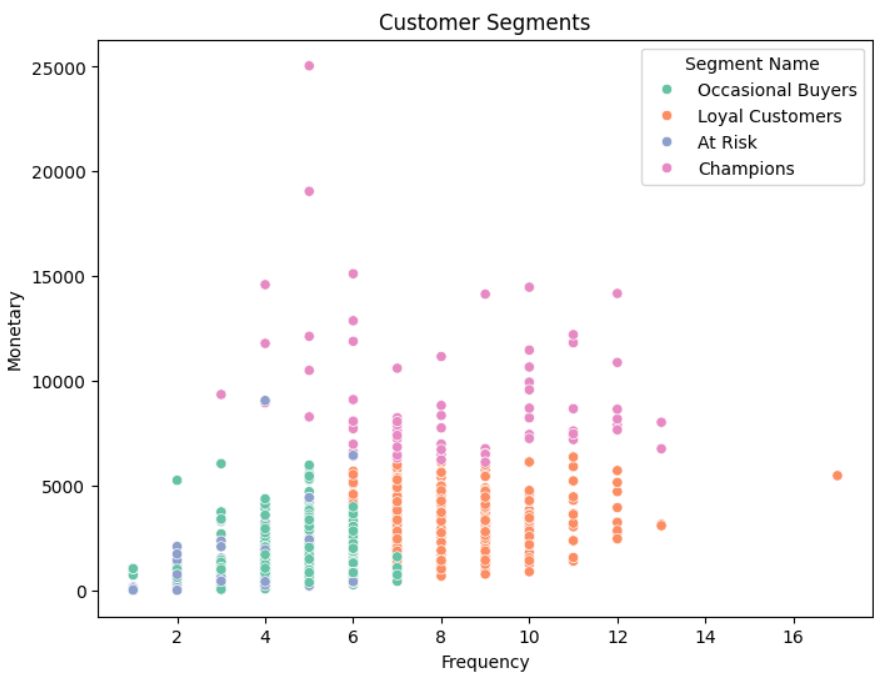
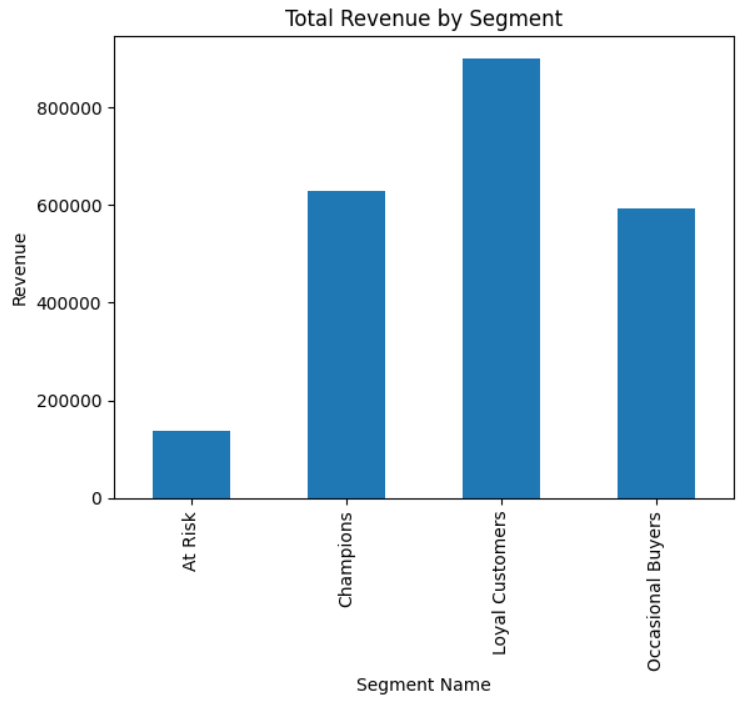

# Customer Segmentation (RFM + K-Means)

## Objective
Segment customers by purchase behavior to enable targeted marketing.

## Dataset
Superstore Sales dataset (9,800 rows, 793 customers) from Kaggle.

## Tools
Python, pandas, scikit-learn, matplotlib, seaborn, Google Colab

## Method
1. Built RFM features (Recency, Frequency, Monetary) for each customer
2. Scaled the features with StandardScaler
3. Chose k = 4 clusters using the elbow method
4. Clustered with K-Means and named the segments

## Segments
| Segment | Customers |
|---|---|
| Occasional Buyers | 347 |
| Loyal Customers | 279 |
| At Risk | 99 |
| Champions | 68 |

## Revenue by Segment

## Key Insights
- Loyal Customers generate the most revenue (about 9 lakh).
- Champions are only about 9% of customers but contribute roughly as much revenue as the 347 Occasional Buyers.
- At Risk customers have not ordered in about 556 days on average and contribute the least revenue.
- Occasional Buyers are the largest group and the best target for upselling.

## Recommendations
- Reward Champions with a loyalty program.
- Keep Loyal Customers engaged with bundles and regular offers.
- Win back At Risk customers with discount campaigns.
- Encourage Occasional Buyers to order more often with targeted promotions.

## Files
- Customer_Segmentation.ipynb: full notebook with code and charts
- sales_working.csv: dataset
